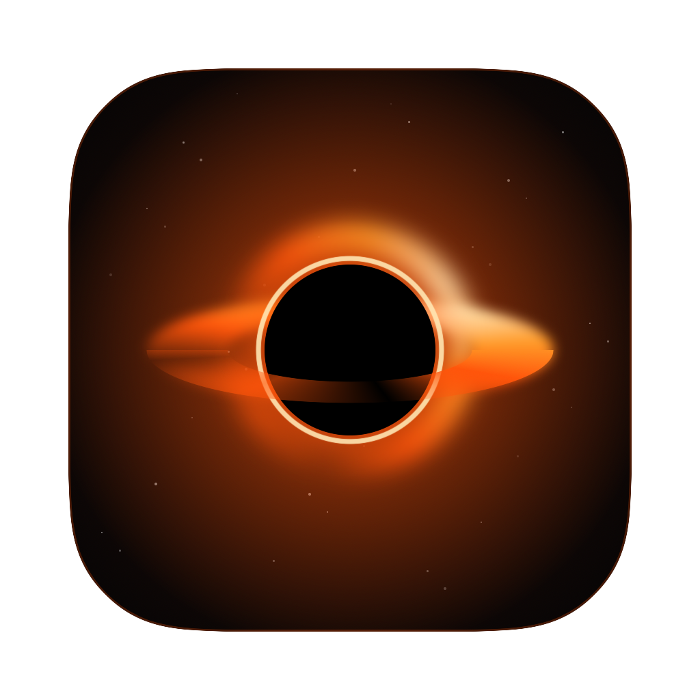
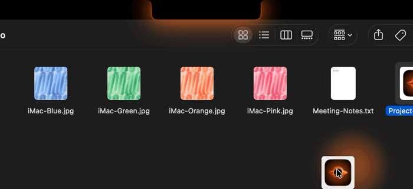
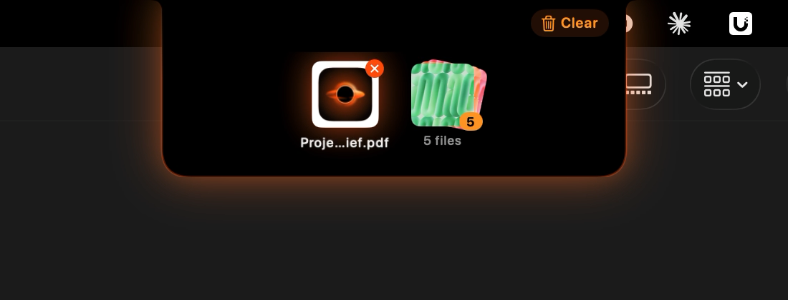
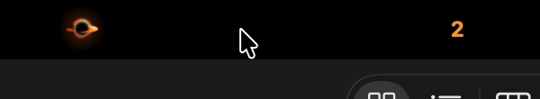

<p align="center">
  
</p>

<h1 align="center">EventHorizon</h1>

<p align="center">
  A tiny file shelf that lives in your MacBook's notch.<br>
  Drag a file to the notch, watch it fall into a black hole, drag it back out whenever you need it.
</p>

<!-- 📸 PLACEHOLDER: screen recording of dragging a file into the notch (the black hole + spiral animation). ~5 s GIF, crop to the top of the screen. -->
<p align="center">
  
</p>

## Features

- **Drop into the notch** – files get sucked into a glowing black hole.
- **Glow while dragging** – the notch lights up as soon as you pick up a file and burns brighter the closer you get.
- **Drag back out** – grab a file from the shelf and drop it anywhere.
- **Stacks** – files dropped together stay together and come out together.
- **Out of the way** – no Dock icon, no menu bar icon, starts at login, tiny and native (Swift + SwiftUI).

<!-- 📸 PLACEHOLDER: screenshot of the open shelf with a few files (hover the notch). -->
<p align="center">
  
</p>

## Install

### Option 1: Download (no developer tools needed)

1. Download `EventHorizon.zip` from the [latest release](https://github.com/Zapeman02/EventHorizon/releases/latest).
2. Unzip it and drag **EventHorizon.app** into your **Applications** folder.
3. Open it. macOS will say it *can't verify the developer* because the app isn't notarized by Apple.
   Go to **System Settings → Privacy & Security**, scroll down and click **Open Anyway**.

   Or run this once in Terminal instead:
   ```sh
   xattr -dr com.apple.quarantine /Applications/EventHorizon.app
   ```

### Option 2: Build from source

Requires Apple's free Command Line Tools (`xcode-select --install`). Full Xcode is not needed.

```sh
git clone https://github.com/Zapeman02/EventHorizon.git
cd EventHorizon
./build.sh install
```

This builds the app, copies it to `/Applications` and launches it.

## Usage

| Do this | What happens |
| --- | --- |
| Drag a file to the notch | It opens and swallows the file |
| Hover the notch | The shelf opens (only when it has files) |
| Drag a file from the shelf | Drops it wherever you let go |
| Hover a file → ✕ | Removes it from the shelf |
| **Clear** button | Empties the shelf |
| Right-click the shelf | Clear shelf / Quit |

The shelf only keeps references to your files. Nothing is copied, and the shelf is empty after a restart.

<!-- 📸 PLACEHOLDER: screenshot of the closed notch with files in it (mini black hole on the left, count on the right). -->
<p align="center">
  
</p>

## Good to know

- **macOS 14 Sonoma or later.** Made for MacBooks with a notch. On other displays it shows a small black pill at the top center.
- **Starts at login.** You can turn this off in **System Settings → General → Login Items**.
- **Folder access.** The first time you drop a file from Desktop, Documents or Downloads, macOS asks if EventHorizon may access that folder. Click Allow. It only asks once per folder.
- **Quit.** Right-click the open shelf and choose **Quit EventHorizon**.

## Uninstall

Quit the app, then delete `/Applications/EventHorizon.app`.

## License

[MIT](LICENSE) © Kasper Back. Free to use, modify and share. Just keep the copyright notice.
