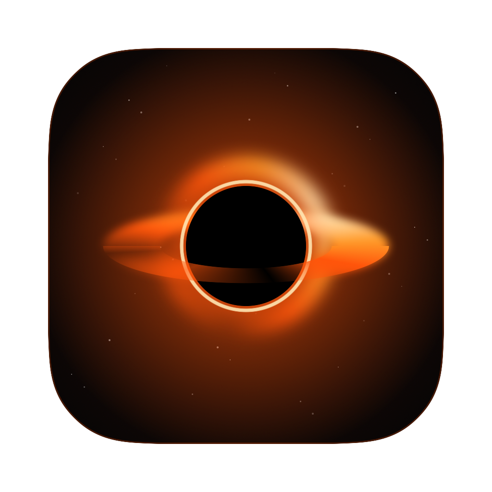
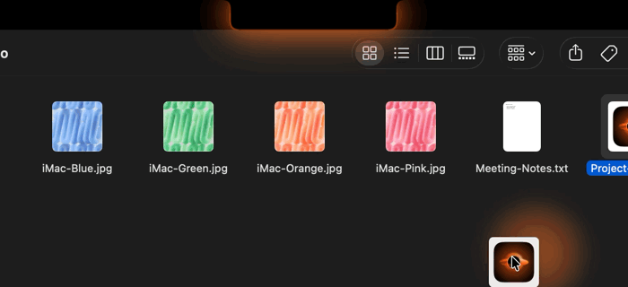
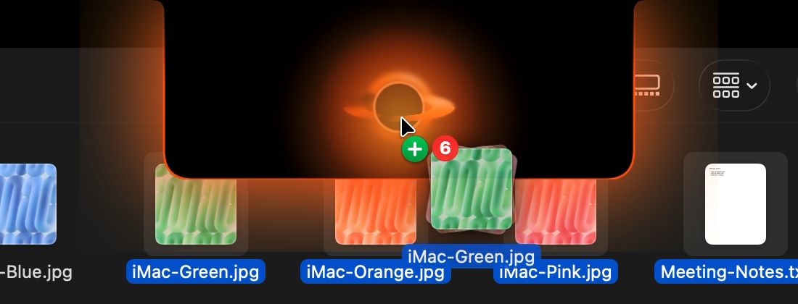
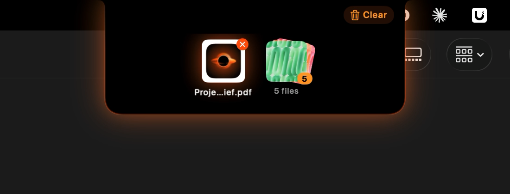
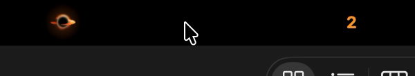

<p align="center">
  
</p>

<h1 align="center">EventHorizon</h1>

<p align="center">
  A tiny file shelf that lives in your MacBook's notch.<br>
  Drag a file to the notch, watch it fall into a black hole, drag it back out whenever you need it.
</p>

<p align="center">
  
</p>

## Features

- **Drop into the notch** – files get sucked into a glowing black hole.
- **Glow while dragging** – the notch lights up as soon as you pick up a file and burns brighter the closer you get.
- **Drag back out** – grab a file from the shelf and drop it anywhere.
- **Stacks** – files dropped together stay together and come out together.
- **Move or copy** – pick how files leave the shelf: Default, Move or Copy. Moved files leave the shelf, copies stay.
- **Out of the way** – no Dock icon, no menu bar icon, starts at login, tiny and native (Swift + SwiftUI).

<p align="center">
  
  
</p>

## Install

1. Download `EventHorizon.zip` from the [latest release](https://github.com/Zapeman02/EventHorizon/releases/latest).
2. Unzip it and drag **EventHorizon.app** into your **Applications** folder.
3. Open it. macOS will say it *can't verify the developer* because the app isn't notarized by Apple.
   Go to **System Settings → Privacy & Security**, scroll down and click **Open Anyway**.

   Or run this once in Terminal instead:
   ```sh
   xattr -dr com.apple.quarantine /Applications/EventHorizon.app
   ```

## Usage

| Do this | What happens |
| --- | --- |
| Drag a file to the notch | It opens and swallows the file |
| Hover the notch | The shelf opens (only when it has files) |
| Drag a file from the shelf | Drops it wherever you let go |
| Mode button (top left) | Choose Default, Move or Copy |
| Hold ⌥ / ⌘ while dragging out | Copy / move just this once |
| Hover a file → ✕ | Removes it from the shelf |
| **Clear** button | Empties the shelf |
| Right-click the shelf | Clear shelf / Settings / Quit |

The shelf only keeps references to your files. Nothing is copied, and the shelf is empty after a restart.

### Drag modes

| Mode | Into Finder | Into apps (browser upload, Mail, …) | On the shelf afterwards |
| --- | --- | --- | --- |
| **Default** | Moves on the same disk, copies to other disks | Copies | Removed if moved, kept if copied |
| **Move** | Moves | Copies | Removed if moved, kept if copied |
| **Copy** | Copies | Copies | Kept |

Holding ⌥ forces a copy and ⌘ forces a move, whatever the mode. The mode button and the badge on the dragged file show what will happen.

<p align="center">
  
</p>

## Good to know

- **macOS 14 Sonoma or later.** Made for MacBooks with a notch. On other displays it shows a small black pill at the top center.
- **Starts at login.** Turn it off under right-click → **Settings…**, along with the drag mode and update checks.
- **Folder access.** The first time you drop a file from Desktop, Documents or Downloads, macOS asks if EventHorizon may access that folder. Click Allow. It only asks once per folder.
- **Quit.** Right-click the open shelf and choose **Quit EventHorizon**.

## Uninstall

Quit the app, then delete `/Applications/EventHorizon.app`.

## Updates

The first time you open EventHorizon it asks whether it may check for updates at startup. If you say yes, it looks at the latest release on GitHub each time it starts. Offline? It just skips the check.

When a newer version is out you get three choices:

- **Download & Install** – downloads the new version, replaces the old one and restarts. No "Open Anyway" step needed.
- **Open on GitHub** – opens the release page so you can download it yourself.
- **Later** – asks again next time.

Every release is signed with the developer's private key, and the app only installs a download whose signature matches the public key built into it. If the signature is missing or wrong, nothing is installed and you get a warning with the option to download manually instead.

## Build from source

Requires Apple's free Command Line Tools (`xcode-select --install`). Full Xcode is not needed.

```sh
git clone https://github.com/Zapeman02/EventHorizon.git
cd EventHorizon
./build.sh install
```

This builds the app, copies it to `/Applications` and launches it.

Run the tests with:

```sh
swift test
```

### Releasing

1. Once: `./build.sh keygen` creates the signing key in your Keychain (**EventHorizon Signing Key**) and prints the public key. Put it in `releasePublicKey` in `Sources/UpdateChecker.swift`, and back up the private key in a password manager.
2. Bump `CFBundleShortVersionString` in `Info.plist`.
3. `./build.sh release` builds `build/EventHorizon.zip` and signs it into `build/EventHorizon.zip.sig`.
4. Create a GitHub release tagged `v<version>` (e.g. `v2.0`) and upload **both** files.

## License

[MIT](LICENSE) © Kasper Back. Free to use, modify and share. Just keep the copyright notice.
